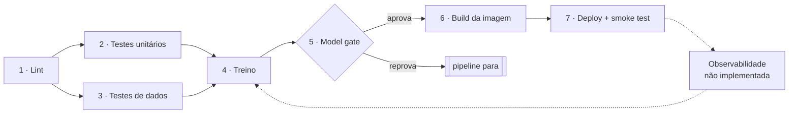

# Aula 2 — o diagrama da esteira (rascunho para o capstone)

> Rascunho. Exercício da Aula 2 que os slides mandam guardar: *"ele volta no trabalho final"* (Aula 02, p. 20).
> Entregável da Proposta B (Aula 02, p. 22): o diagrama das sete etapas, com as etapas 3 (dados) e 5 (gate)
> detalhadas, e a decisão sobre o lote. Os números vêm de `../aula2/README.md` e `../aula2/evidencias/`.

## As sete etapas, como estão no repositório

| Etapa | Onde | Critério (o `if`) | Se falhar |
| --- | --- | --- | --- |
| 1 · Lint | `ci-classificador.yml` | `ruff check` e `ruff format --check` sem erro | job vermelho; nada mais roda |
| 2 · Testes unitários | `classificador/tests/test_texto.py` | 100% passam | job vermelho |
| 3 · Testes de dados | `classificador/tests/test_dados.py` | tabela abaixo | bloqueia; algumas regras só alertam |
| 4 · Treino | `classificador/treino.py` | treina sem erro e grava `artefatos/metricas.json` | job vermelho |
| 5 · Model gate | `classificador/model_gate.py` | tabela abaixo | `exit 1`: nada é publicado |
| 6 · Build | `classificador/Dockerfile` | `docker build` sem erro | sem imagem, sem deploy |
| 7 · Deploy | `deploy-classificador.yml` (Lambda) | `curl -f` na URL pública responde 2xx | job vermelho, mas o tráfego já foi trocado (problema 7 do relatório da Aula 2) |
| Observabilidade | — | **não implementada** para o classificador | — |

Um job vermelho só **bloqueia o merge** se o check for obrigatório no ruleset da `main` (problema 8 da Aula 2).

## Etapa 3 — testes de dados (limites reais)

| Regra | Limite | Tipo |
| --- | --- | --- |
| Schema | colunas exatamente `texto`, `rotulo` | bloqueia |
| Texto vazio | nenhum | bloqueia |
| Rótulos válidos | só `positiva`, `negativa`, `neutra` | bloqueia |
| Volume | ≥ 300 linhas | bloqueia |
| Textos só com emoji | ≤ 10% | bloqueia |
| Distribuição das classes (referência 40/35/25%) | desvio > 5 p.p. alerta; > 10 p.p. bloqueia | alerta + bloqueio |
| Média de palavras por texto (referência 11,15, depois de `texto.limpar`) | desvio > 10% alerta; > 20% bloqueia | alerta + bloqueio (**PR #10**, ainda não está na `main`) |

**Por que 20% e não os ±30% do enunciado do Desafio:** o `lote-novo.csv` está a −27,8%, então ±30% o deixaria
passar. O ruído da média num lote de 300 linhas fica abaixo de 6,5% (p99, *bootstrap* da base de treino). Detalhes:
seção 7 de `../aula2/README.md`.

## Etapa 5 — model gate (limites reais)

| Regra | Limite |
| --- | --- |
| F1 macro do candidato | ≥ 0,80 |
| F1 de **cada** classe | ≥ 0,70 (a média não esconde uma classe ruim) |
| Queda em relação à produção (`classificador/producao.json`, F1 macro 0,82) | ≤ 0,02 |

## A decisão: o `lote-novo.csv` vira modelo?

**Não.** Ele é barrado duas vezes, e a primeira barreira é a mais barata (antes de gastar tempo treinando):

| Barreira | O que mediu | Resultado |
| --- | --- | --- |
| Etapa 3 (dados) | 28% de textos só com emoji (máx. 10%) | bloqueia |
| Etapa 3 (dados) | `neutra` em 9% (referência 25%, −16 p.p.) | alerta e bloqueia |
| Etapa 3 (dados) | `positiva` em 52% (referência 40%, +12 p.p.) | alerta e bloqueia |
| Etapa 3 (dados, PR #10) | média de 8,05 palavras (referência 11,15, −28%) | alerta e bloqueia |
| Etapa 5 (gate), se o lote passasse | F1 macro 0,731 (< 0,80); `neutra` 0,5833 (< 0,70); queda de 0,089 em relação a 0,82 | reprova pelos três motivos |

O piso por classe é o que importa aqui: com F1 macro 0,731, um gate só pela média, com limite 0,70, aprovaria um modelo
com F1 0,58 na `neutra`.

## O que falta para o capstone

- **Observabilidade (Proposta C, Aula 02, p. 23):** os sinais sem rótulo (distribuição das previsões, confiança média,
  tamanho do texto de entrada) não são medidos em produção. Hoje só o canary da Aula 4 compara a distribuição das
  previsões. *A confirmar com o enunciado da Aula 6 se entra no capstone.*
- **A mesma esteira para o agente:** no capstone, a etapa 5 é o **agent gate** (Aula 6), não o model gate. O diagrama
  do agente tem a mesma forma: lint → testes → golden dataset (promptfoo) → agent gate por categoria → build → deploy.
